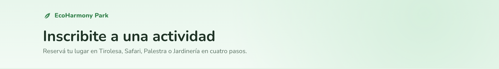
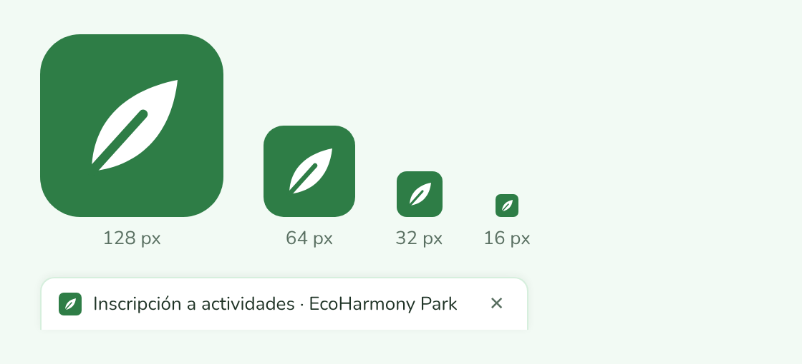
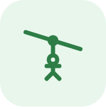
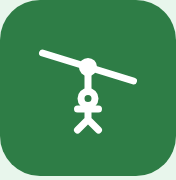

# Supuestos — Inscribirme a actividad

La historia de usuario define **qué** tiene que pasar (elegir actividad con cupo, horario, cantidad de personas, datos de cada visitante, talla si corresponde, aceptar términos, recibir un mail con QR), pero no define muchos datos concretos: horarios del parque, cupos, talles, textos, identidad visual, etc.

Este documento registra **todo lo que supusimos o inventamos** para poder implementarla, con el valor elegido, el motivo y el archivo donde se cambia. Si la cátedra o el cliente define otros valores, se ajustan ahí y los tests indican qué hay que actualizar.

> Las decisiones de arquitectura (tecnologías, base de datos, TDD) están en [`DECISIONES_TECNICAS.md`](DECISIONES_TECNICAS.md).
>
> Las **preguntas para el PO** que confirman o corrigen estos supuestos están al final, en el [punto 11](#11-preguntas-para-el-po).

---

## Índice

1. [Identidad visual: nombre, logo, favicon e íconos](#1-identidad-visual-nombre-logo-favicon-e-íconos)
2. [Horario y días de apertura del parque](#2-horario-y-días-de-apertura-del-parque)
3. [Actividades: horarios, cupos y talla](#3-actividades-horarios-cupos-y-talla)
4. [Datos de la inscripción y de cada participante](#4-datos-de-la-inscripción-y-de-cada-participante)
5. [Disponibilidad y cupos](#5-disponibilidad-y-cupos)
6. [Términos y condiciones](#6-términos-y-condiciones)
7. [Email de confirmación y código QR](#7-email-de-confirmación-y-código-qr)
8. [Reglas de negocio que dejamos afuera](#8-reglas-de-negocio-que-dejamos-afuera)
9. [Supuestos técnicos y de entorno](#9-supuestos-técnicos-y-de-entorno)
10. [Resumen: dónde se cambia cada supuesto](#10-resumen-dónde-se-cambia-cada-supuesto)
11. [Preguntas para el PO](#11-preguntas-para-el-po)

---

## 1. Identidad visual: nombre, logo, favicon e íconos

La historia no menciona el nombre del parque ni una marca. El nombre **EcoHarmony Park** lo definió el equipo; el resto de la identidad visual (logo, favicon, íconos) la **inventamos** para que la aplicación sea coherente con ese nombre. Todos los gráficos son **dibujos propios en SVG** hechos para este TP (no se usaron imágenes ni íconos de terceros), así que no hay problemas de derechos de autor.

### 1.1 Nombre del parque

| Supuesto | Valor | Dónde aparece |
|---|---|---|
| Nombre | **EcoHarmony Park** (definido por el equipo) | Encabezado de todas las páginas, título de la pestaña, remitente y textos del mail, primera línea del QR (`ECOHARMONY PARK - INSCRIPCIÓN CONFIRMADA`) |
| Título de la pestaña | "Inscripción a actividades · EcoHarmony Park" | `frontend/index.html` |

### 1.2 Logo

Una **hoja** estilizada (por la idea "eco" del nombre, el entorno natural del parque y la actividad de Jardinería) en el verde principal `rgb(46, 125, 70)`, acompañada del nombre en tipografía **Nunito ExtraBold**. Es un enlace que lleva al formulario.

Cómo se ve en el encabezado de la aplicación:

- Archivo: `frontend/src/componentes/Encabezado.jsx` (SVG dentro del componente).

### 1.3 Favicon

La misma hoja, en blanco sobre un cuadrado redondeado verde `rgb(46, 125, 70)`, para que se distinga en la pestaña del navegador. Es un SVG, así que se ve nítido en cualquier tamaño.

- Archivo: `frontend/public/favicon.svg`, enlazado desde `frontend/index.html`.
- El color de la barra del navegador en celulares (`theme-color`) también es `rgb(46, 125, 70)`.

### 1.4 Íconos de las actividades

Cada actividad tiene un ícono de línea propio (trazo de 2 px sobre una grilla de 32 × 32). Se muestran en una caja verde clarito y, cuando la actividad está **seleccionada**, se invierten: ícono blanco sobre verde.

| Actividad | Qué representa | Normal | Seleccionada |
|---|---|---|---|
| **Tirolesa** | Una persona colgada de una polea sobre el cable |  |  |
| **Safari** | Binoculares para observar fauna |  |  |
| **Palestra** | Una pared/montaña con presas de escalada |  |  |
| **Jardinería** | Un brote con dos hojas saliendo de la tierra |  |  |

- Archivo: `frontend/src/Iconos.jsx`. Usan `currentColor`, por eso el mismo dibujo sirve para los dos estados.

### 1.5 Ícono de confirmación

Un tilde verde en un círculo verde clarito, que aparece arriba de la pantalla "¡Inscripción registrada!".

- Archivo: `frontend/src/paginas/DetalleInscripcion.jsx`.

### 1.6 Colores, tipografía e idioma

| Supuesto | Valor |
|---|---|
| Paleta | Verde clarito y blanco (pedido del equipo). Valores RGB y contrastes en `DECISIONES_TECNICAS.md` §9 |
| Color principal | `rgb(46, 125, 70)` |
| Fondo | `rgb(242, 250, 244)` y blanco `rgb(255, 255, 255)` |
| Tipografía | **Nunito** (Google Fonts): redondeada y amigable, acorde a un parque. Si no carga, se usa la del sistema |
| Idioma | Español rioplatense con voseo ("Elegí", "Ingresá", "Tenés que aceptar…") |
| Formato de fechas | `es-AR`: "Sábado, 17 de octubre", y `dd/mm/aaaa` en el mail y el QR |
| Formato de horas | 24 h con "hs" ("10:30 hs") |

---

## 2. Horario y días de apertura del parque

La historia pide que falle la inscripción "en un horario en el cual el parque está cerrado", pero no dice cuándo cierra.

| Supuesto | Valor | Motivo |
|---|---|---|
| Horario de apertura | **09:00 a 18:00** | Horario diurno típico de un parque de actividades al aire libre |
| Días abiertos | **Martes a domingo** | |
| Día de cierre semanal | **Lunes** (mantenimiento) | Es habitual que los parques cierren un día de semana para mantenimiento; elegimos el lunes |
| Feriados cerrados | **25/12** (Navidad) y **01/01** (Año Nuevo) | Los únicos dos que consideramos; el resto de los feriados el parque abre |
| Hora límite | Un turno es válido si **empieza** antes de las 18:00 | No modelamos la duración (ver §3) |

- Archivo: `backend/src/domain/parque.js` (`HORA_APERTURA`, `HORA_CIERRE`, `DIAS_CERRADO`, `FERIADOS_CERRADO`).
- Test: `test_InscribirmeActividad_HorarioParqueCerrado_NoPasa`.

---

## 3. Actividades: horarios, cupos y talla

La historia nombra las cuatro actividades y dice que algunas piden talla de vestimenta, pero no dice cuáles, ni sus horarios, ni cuántos lugares tienen.

### 3.1 Horarios y cupos

| Actividad | Horarios (inicio de cada turno) | Cupo por turno | Turnos por día | Lugares por día |
|---|---|---|---|---|
| **Tirolesa** | 09:00 · 10:30 · 12:00 · 14:00 · 15:30 · 17:00 | **10** | 6 | 60 |
| **Safari** | 09:30 · 11:30 · 14:30 · 16:30 | **20** | 4 | 80 |
| **Palestra** | 10:00 · 11:00 · 13:00 · 15:00 · 16:00 | **8** | 5 | 40 |
| **Jardinería** | 10:00 · 14:00 · 16:00 | **15** | 3 | 45 |

Criterios usados para inventar estos números:

- **Tirolesa (10):** se lanza de a una persona; 10 por turno permite rotar el equipo en 1 h 30.
- **Safari (20):** un vehículo abierto mediano con un guía.
- **Palestra (8):** es la más restrictiva porque cada escalador necesita un instructor que lo asegure (el muro tiene pocas vías).
- **Jardinería (15):** un taller con mesas compartidas y un tallerista.
- Los horarios se intercalan para que una familia pueda hacer varias actividades el mismo día.
- Los turnos son **los mismos todos los días** que abre el parque (no hay horarios especiales de fin de semana).
- **No se modela la duración** de cada actividad: el horario es la hora de inicio. Suponemos que todas terminan antes del cierre (la última, Tirolesa 17:00, dura menos de una hora).

### 3.2 Talla de vestimenta

| Actividad | ¿Pide talla? | Para qué (texto que ve el visitante) |
|---|---|---|
| **Tirolesa** | **Sí** | "Se entrega arnés y chaleco según la talla." |
| **Safari** | No | — |
| **Palestra** | **Sí** | "Se entrega arnés y calzado de escalada según la talla." |
| **Jardinería** | No | — |

- **Tallas válidas:** `XS`, `S`, `M`, `L`, `XL`, `XXL` (las mismas para todas las actividades y para chicos y adultos).
- Si la actividad no pide talla, el campo **no se muestra** y, si igual llega una talla en el pedido, el backend la **ignora** (se guarda vacía).
- La talla es **por participante**, no una sola por inscripción.

### 3.3 Descripciones

Las descripciones de las tarjetas son inventadas:

| Actividad | Descripción |
|---|---|
| Tirolesa | Recorrido de 400 metros suspendido sobre la copa de los árboles. |
| Safari | Paseo guiado en vehículo abierto para observar la fauna del parque. |
| Palestra | Muro de escalada de 12 metros con rutas para todos los niveles. |
| Jardinería | Taller de huerta y plantas nativas. Te llevás tu plantín a casa. |

- Archivo de todo §3: `backend/src/domain/actividades.js`.

---

## 4. Datos de la inscripción y de cada participante

La historia dice "nombre, DNI, edad y talla de vestimenta si la actividad lo demanda", sin formatos ni límites.

| Dato | Supuesto | Motivo |
|---|---|---|
| Cantidad de personas | **Mínimo 1, máximo 10** por inscripción | Un grupo familiar o de amigos; grupos más grandes (escuelas, empresas) se gestionarían aparte |
| Participantes | Hay que cargar los datos de **todas** las personas, no solo del que inscribe | La historia dice "para cada persona que participa" |
| Nombre | Obligatorio, **al menos 2 caracteres**, en un solo campo "Nombre y apellido" | Simplicidad; no se separa nombre de apellido |
| DNI | **7 u 8 dígitos, solo números, sin puntos** | Formato de DNI argentino. No se valida que el número exista |
| DNI repetido | **No se permite** el mismo DNI dos veces **dentro de la misma inscripción** | Evita cargar dos veces a la misma persona por error |
| Edad | Número entero **entre 0 y 120** | Rango amplio; la edad mínima por actividad no se valida (ver §6) |
| Talla | Obligatoria solo si la actividad la pide (ver §3.2) | |
| Email | **Uno por inscripción** (de quien inscribe), no uno por participante. Formato `algo@dominio.ext` | El mail de confirmación va a una sola persona |
| Visitante extranjero | Sin campo de pasaporte; se carga el número en el campo DNI si cumple el formato | No lo pide la historia |
| Código de inscripción | `INS-` + 8 caracteres hexadecimales al azar (ej. `INS-439E3BBC`) | Corto, fácil de dictar y difícil de adivinar |

- Archivos: `backend/src/services/inscripcionService.js` (validación definitiva) y `frontend/src/validacion.js` (la misma validación, para avisar antes de enviar).

---

## 5. Disponibilidad y cupos

| Supuesto | Valor |
|---|---|
| Cómo se cuenta el cupo | Por **turno** = actividad + fecha + horario. Cada inscripción ocupa tantos lugares como personas tenga |
| Cupo parcial | Si quedan 3 lugares y se piden 4, **falla toda la inscripción** (no se inscribe a 3 y se deja afuera a 1). El mensaje dice cuántos lugares quedan |
| "Actividad no disponible" | El horario elegido **no es uno de los turnos** de esa actividad, o **ya empezó** |
| "Parque cerrado" | La fecha cae en lunes, 25/12 o 01/01, o la hora está fuera de 09:00–18:00 |
| Fechas pasadas | No se puede inscribir a una fecha anterior a hoy |
| Mismo día | Se puede inscribir hoy a un turno que **todavía no empezó** |
| Anticipación máxima | **Sin límite**: se puede reservar para cualquier fecha futura |
| Último lugar | Si dos personas piden el último lugar al mismo tiempo, solo una lo consigue (ver `DECISIONES_TECNICAS.md` §6) |
| Lugares liberados | Como no hay cancelaciones (ver §8), un cupo ocupado no se libera |

---

## 6. Términos y condiciones

La historia pide "aceptar los términos y condiciones específicos de la actividad", pero no da el texto.

| Supuesto | Valor |
|---|---|
| Texto | **Inventado** para el TP. Cada actividad tiene sus cláusulas propias, y además hay **condiciones generales del parque** que valen para todas |
| Versión | `2026-10` |
| Cómo se leen | Las palabras "términos y condiciones" del check son un **enlace** a una página aparte (`/terminos/<actividad>`) |
| Aceptación | Explícita: hay que **marcar el check** (o tocar "Acepto" en la página de términos). Abrir el enlace no los acepta |
| Cambio de actividad | Si el visitante cambia de actividad, el check **se desmarca** y hay que volver a aceptar |
| Constancia | Se guarda en la base una **copia del texto exacto** que se aceptó |
| Una aceptación por inscripción | La acepta quien inscribe, en nombre de todo el grupo |

**Contenido inventado más relevante** (completo en la página de términos y en `backend/src/domain/actividades.js`):

- **Tirolesa:** peso máximo **110 kg**, edad mínima **8 años**, uso obligatorio de arnés, casco y chaleco, sin objetos sueltos.
- **Safari:** permanecer sentado, no alimentar ni tocar a los animales.
- **Palestra:** edad mínima **6 años**, escalar solo con instructor.
- **Jardinería:** informar alergias, menores de 12 años con un adulto.
- **Generales:** presentar DNI y QR al ingresar, llegar **15 minutos antes**, el lugar se libera a los **10 minutos** de empezado, **menores de 18** acompañados por un adulto, el parque puede suspender por clima.

> **Importante:** la edad mínima y el peso máximo figuran en los términos, pero **el sistema no los valida** (la historia no lo pide). Se controlan en el lugar, al ingresar. Está anotado como mejora posible.

---

## 7. Email de confirmación y código QR

| Supuesto | Valor |
|---|---|
| Destinatario | El email que se carga en el formulario |
| Remitente | "EcoHarmony Park" &lt;grupoecoharmonypark@gmail.com&gt;, enviado a través de Brevo (configurado en `backend/.env`) |
| Asunto | `Inscripción confirmada: <Actividad> — <día dd/mm/aaaa> <hora> hs` |
| Proveedor de correo | **Brevo** (plan gratuito). Gmail directo no fue posible porque Google no permitió crear la contraseña de aplicación en la cuenta nueva. Sirve cualquier servidor SMTP |
| Sin configuración | Si no hay `.env`, el mail se guarda como archivo en `backend/outbox/` en vez de enviarse |
| Si falla el envío | La inscripción **queda registrada igual**; se avisa en pantalla y se muestra el QR para guardarlo |
| Contenido del QR | **Texto** con el detalle completo: código, actividad, fecha, horario, cada participante con DNI, edad y talla, email y términos aceptados |
| Por qué texto | Se puede leer con la cámara de cualquier celular, **sin internet** y sin app propia. Un link a `localhost` no funcionaría desde el celular |
| DNI en el QR | Se incluye, porque el personal lo compara con el DNI físico al ingresar. Quien tenga el QR puede ver esos datos |
| Link en el QR | Opcional: si se configura `URL_PUBLICA` con la IP de la PC en la red, el QR y el mail suman un link a la página de detalle |
| Reenvío | No hay botón para reenviar el mail; el detalle se puede volver a ver en `/inscripcion/<código>` |

---

## 8. Reglas de negocio que dejamos afuera

Cosas que un sistema real probablemente tendría, pero que **supusimos fuera del alcance** de esta historia:

| Tema | Supuesto |
|---|---|
| **Pago** | Las actividades **no se cobran** (o se pagan en el parque). No hay precios ni pasarela de pago |
| **Cuenta de usuario** | No hay registro ni inicio de sesión: cualquier visitante se inscribe con sus datos |
| **Cancelar o modificar** | No se puede cancelar ni cambiar una inscripción desde la aplicación |
| **Misma persona en varios turnos** | Se permite inscribir a la misma persona en varias actividades y turnos, **aunque se superpongan**. Tampoco se controla que un mismo DNI aparezca en dos inscripciones distintas del mismo turno |
| **Entrada al parque** | La inscripción a la actividad no incluye ni verifica la entrada general al parque |
| **Clima / suspensiones** | No hay forma de suspender un turno desde el sistema; los términos dicen que se avisaría por mail |
| **Panel del personal** | No hay pantalla para que el parque vea los inscriptos por turno ni para escanear los QR en el ingreso |
| **Lista de espera** | Si un turno se llena, no hay lista de espera |

---

## 9. Supuestos técnicos y de entorno

| Supuesto | Valor |
|---|---|
| Zona horaria | La de la **PC donde corre el backend**. "Hoy" y "el turno ya empezó" se calculan con ese reloj |
| Un solo servidor | Corre en una sola PC; la base de datos es un archivo local (`backend/data/parque.sqlite`) |
| Navegadores | Versiones actuales de Chrome, Edge, Firefox y Safari (escritorio y celular) |
| Puertos | Backend `3001`, frontend `5173` |
| Node.js | Versión 18 o superior |
| Datos de prueba | En los tests, el "ahora" es el **viernes 09/10/2026 a las 08:00**; el sábado 10/10 es un día abierto y el lunes 12/10 un día cerrado |

---

## 10. Resumen: dónde se cambia cada supuesto

| Supuesto | Archivo | Qué tocar |
|---|---|---|
| Horario de apertura y cierre | `backend/src/domain/parque.js` | `HORA_APERTURA`, `HORA_CIERRE` |
| Día de cierre semanal | `backend/src/domain/parque.js` | `DIAS_CERRADO` (0 = domingo, 1 = lunes…) |
| Feriados cerrados | `backend/src/domain/parque.js` | `FERIADOS_CERRADO` (formato `MM-DD`) |
| Horarios de cada actividad | `backend/src/domain/actividades.js` | `horarios` |
| Cupo por turno | `backend/src/domain/actividades.js` | `cupoPorHorario` |
| Qué actividades piden talla | `backend/src/domain/actividades.js` | `requiereTalla`, `motivoTalla` |
| Tallas válidas | `backend/src/domain/actividades.js` | `TALLAS_VALIDAS` |
| Texto de los términos | `backend/src/domain/actividades.js` | `terminos` de cada actividad, `TERMINOS_GENERALES`, `VERSION_TERMINOS` |
| Máximo de personas | `backend/src/services/inscripcionService.js` y `frontend/src/validacion.js` | `MAX_PERSONAS_POR_INSCRIPCION` y `MAX_PERSONAS` (cambiar los dos) |
| Formato de DNI, edad, email | `backend/src/services/inscripcionService.js` y `frontend/src/validacion.js` | `REGEX_DNI`, `REGEX_EMAIL`, rango de edad |
| Contenido del QR | `backend/src/services/inscripcionService.js` | `armarContenidoQR` |
| Diseño del mail | `backend/src/services/mailService.js` | `armarHtml` |
| Cuenta de correo | `backend/.env` | `SMTP_*`, `MAIL_FROM` |
| Nombre y logo | `frontend/src/componentes/Encabezado.jsx`, `frontend/index.html`, `backend/src/services/mailService.js`, `backend/src/services/inscripcionService.js` | Texto y SVG del encabezado, título de la pestaña, remitente y encabezado del mail, primera línea del QR |
| Favicon | `frontend/public/favicon.svg` | SVG |
| Íconos de actividades | `frontend/src/Iconos.jsx` | SVG de cada actividad |
| Colores | `frontend/src/styles.css` | Variables en `:root` |

> El catálogo de actividades también se copia a la tabla `actividades` de la base cada vez que arranca el backend, así que alcanza con cambiar el código y reiniciar.

---

## 11. Preguntas para el PO

Estas son las preguntas que le queremos hacer al Product Owner (los profesores) para **confirmar o corregir** los supuestos anteriores. Cada una indica qué supusimos y en qué sección está el detalle, y deja un espacio para anotar la respuesta.

> **Cómo usar esta sección:** en la reunión con el PO, completar "Respuesta del PO". Si la respuesta cambia un supuesto, se actualiza la sección correspondiente y el archivo indicado en la [tabla del punto 10](#10-resumen-dónde-se-cambia-cada-supuesto); los tests muestran qué más hay que ajustar.

### Parque y horarios

**P1. ¿En qué horario abre y cierra el parque?**
- Supusimos: de 09:00 a 18:00 (§2).
- Respuesta del PO:

**P2. ¿Qué días de la semana cierra el parque?**
- Supusimos: abre de martes a domingo y cierra los lunes por mantenimiento (§2).
- Respuesta del PO:

**P3. ¿En qué feriados o fechas especiales cierra? ¿Tiene horarios distintos en fines de semana, vacaciones o temporada baja?**
- Supusimos: cierra solo el 25/12 y el 01/01, con el mismo horario todo el año (§2).
- Respuesta del PO:

**P4. ¿Cuánto dura cada actividad? Un turno, ¿tiene que terminar antes del cierre o alcanza con que empiece antes?**
- Supusimos: no modelamos la duración; alcanza con que el turno empiece antes de las 18:00 (§2 y §3.1).
- Respuesta del PO:

### Actividades y cupos

**P5. ¿En qué horarios se dicta cada actividad?**
- Supusimos: Tirolesa 09:00, 10:30, 12:00, 14:00, 15:30 y 17:00 · Safari 09:30, 11:30, 14:30 y 16:30 · Palestra 10:00, 11:00, 13:00, 15:00 y 16:00 · Jardinería 10:00, 14:00 y 16:00 (§3.1).
- Respuesta del PO:

**P6. ¿Cuántos lugares tiene cada turno de cada actividad?**
- Supusimos: Tirolesa 10 · Safari 20 · Palestra 8 · Jardinería 15 (§3.1).
- Respuesta del PO:

**P7. ¿Los horarios y los cupos son los mismos todos los días, o cambian según el día?**
- Supusimos: son iguales todos los días que abre el parque (§3.1).
- Respuesta del PO:

**P8. ¿Qué actividades requieren talla de vestimenta, y para qué se usa?**
- Supusimos: Tirolesa (arnés y chaleco) y Palestra (arnés y calzado). Safari y Jardinería no (§3.2).
- Respuesta del PO:

**P9. ¿Qué talles se manejan? ¿Hay talles para chicos? En Palestra, ¿la talla es de ropa o el número de calzado?**
- Supusimos: XS, S, M, L, XL y XXL para todos y para las dos actividades (§3.2).
- Respuesta del PO:

**P10. ¿El personal del parque necesita poder suspender un turno (por ejemplo, por lluvia) o cambiar cupos y horarios desde el sistema?**
- Supusimos: no está en el alcance de esta historia; los valores se cambian en el código (§8).
- Respuesta del PO:

### Inscripción y participantes

**P11. ¿Cuántas personas se pueden inscribir como máximo en una sola inscripción?**
- Supusimos: de 1 a 10 (§4).
- Respuesta del PO:

**P12. ¿Hay que cargar nombre, DNI y edad de todos los participantes, o alcanza con los del titular?**
- Supusimos: de todos, como indica la historia ("para cada persona que participa") (§4).
- Respuesta del PO:

**P13. ¿Qué formato tiene el DNI? ¿Se pueden inscribir visitantes extranjeros con pasaporte?**
- Supusimos: DNI argentino de 7 u 8 números, sin puntos. No hay campo de pasaporte (§4).
- Respuesta del PO:

**P14. ¿El sistema debe rechazar a quien no cumpla la edad mínima o el peso máximo de una actividad?**
- Supusimos: no. Los términos dicen que Tirolesa es desde 8 años y Palestra desde 6, pero eso se controla en el lugar, no al inscribirse (§6).
- Respuesta del PO:

**P15. ¿Un menor de edad puede inscribirse solo, o tiene que haber un adulto en la misma inscripción?**
- Supusimos: el sistema no lo controla; los términos piden que vaya acompañado (§6).
- Respuesta del PO:

**P16. ¿Una misma persona (mismo DNI) puede estar en dos actividades al mismo tiempo, o anotada dos veces en el mismo turno con inscripciones distintas?**
- Supusimos: se permite. Solo se impide repetir el DNI dentro de una misma inscripción (§4 y §8).
- Respuesta del PO:

**P17. ¿El mail de confirmación va a una sola dirección (la del titular) o a cada participante?**
- Supusimos: una sola dirección por inscripción (§4 y §7).
- Respuesta del PO:

**P18. ¿Con cuánta anticipación se puede reservar? ¿Hasta cuánto antes del turno se puede inscribir?**
- Supusimos: sin límite hacia adelante, y se puede inscribir el mismo día mientras el turno no haya empezado (§5).
- Respuesta del PO:

**P19. Si quedan menos lugares que personas en la inscripción, ¿se rechaza todo o se inscribe a los que entran?**
- Supusimos: se rechaza toda la inscripción y se informa cuántos lugares quedan (§5).
- Respuesta del PO:

### Términos y condiciones

**P20. ¿El parque tiene el texto oficial de los términos y condiciones de cada actividad?**
- Supusimos: no; los redactamos nosotros (§6).
- Respuesta del PO:

**P21. ¿Los términos los acepta una sola persona por todo el grupo, o cada participante por separado?**
- Supusimos: los acepta una vez quien hace la inscripción, en nombre del grupo (§6).
- Respuesta del PO:

**P22. ¿Hace falta guardar constancia de qué versión de los términos aceptó cada visitante?**
- Supusimos: sí; guardamos una copia del texto aceptado en la base de datos (§6).
- Respuesta del PO:

### Email y código QR

**P23. ¿Qué datos tiene que incluir el mail de confirmación?**
- Supusimos: código, actividad, fecha, horario, cantidad de personas, nombre, DNI, edad y talla de cada participante, y el QR (§7).
- Respuesta del PO:

**P24. ¿Qué tiene que mostrar el QR al escanearlo: el detalle completo, un link a una página, o solo un código para que el personal lo valide con un lector propio?**
- Supusimos: texto con el detalle completo, que se lee con cualquier celular sin internet (§7).
- Respuesta del PO:

**P25. ¿Es aceptable que el QR incluya los DNI de los participantes? Cualquiera que vea el QR puede leerlos.**
- Supusimos: sí, porque el personal los compara con el DNI físico en el ingreso (§7).
- Respuesta del PO:

**P26. ¿Desde qué dirección de correo tienen que salir los mails? ¿El parque tiene un servidor o dominio de correo propio?**
- Supusimos: la cuenta del equipo grupoecoharmonypark@gmail.com con el nombre "EcoHarmony Park", enviando a través de Brevo (§7).
- Respuesta del PO:

**P27. Si la inscripción se registra pero el mail no se puede enviar, ¿la inscripción sigue siendo válida?**
- Supusimos: sí; el lugar queda reservado y la pantalla muestra el QR para guardarlo (§7).
- Respuesta del PO:

### Alcance

**P28. ¿Las actividades tienen costo? ¿Hay que cobrar al inscribirse?**
- Supusimos: no se cobra en el sistema (§8).
- Respuesta del PO:

**P29. ¿El visitante tiene que poder cancelar o modificar su inscripción?**
- Supusimos: no, queda fuera de esta historia (§8).
- Respuesta del PO:

**P30. ¿El visitante necesita una cuenta con usuario y contraseña para inscribirse?**
- Supusimos: no; se inscribe solo con sus datos (§8).
- Respuesta del PO:

**P31. Si un turno se llena, ¿tiene que haber lista de espera?**
- Supusimos: no (§8).
- Respuesta del PO:

**P32. ¿EcoHarmony Park tiene logo, colores o tipografía propios que debamos usar?**
- Supusimos: usamos una identidad propia (hoja verde, paleta verde clarito y blanco, tipografía Nunito) (§1).
- Respuesta del PO:
